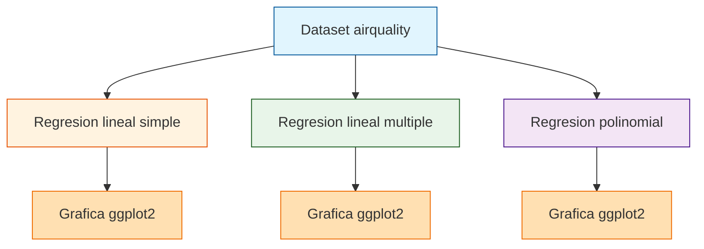

# Figuras de Regresion

<p align="center">
  <a href="https://github.com/Matthew-Garay/Figurasderegresion/actions/workflows/ci.yml"></a>
  <a href="https://github.com/Matthew-Garay/Figurasderegresion/security/dependabot"></a>
</p>

Tres modelos de regresion (lineal simple, lineal multiple y polinomial) sobre el dataset integrado airquality de R, cada uno con su grafica realizada en ggplot2. La variable a predecir es el ozono.

## Stack tecnologico

- **Lenguaje:** R 4.x
- **Visualizacion:** ggplot2
- **Analisis:** Regresion lineal simple, multiple y polinomial

## Arquitectura



## Caracteristicas

- Regresion lineal simple sobre airquality
- Regresion lineal multiple sobre airquality
- Regresion polinomial sobre airquality
- Visualizaciones con ggplot2
- Variable objetivo: ozono

## Como ejecutar

### Requisitos previos

- R 4.x instalado
- Paquete ggplot2

### Ejecucion

1. Clona el repositorio:
   ```bash
   git clone https://github.com/Matthew-Garay/Figurasderegresion.git
   cd Figurasderegresion
   ```
2. Instala ggplot2 si no lo tienes:
   ```r
   install.packages("ggplot2")
   ```
3. Ejecuta el script:
   ```bash
   Rscript P12.R
   ```

## Estructura del proyecto

```
Figurasderegresion/
├── P12.R                    # Codigo fuente en R
├── .gitignore               # Archivos excluidos del control de versiones
├── LICENSE                  # Licencia MIT
├── README.md                # Este archivo
└── docs/                    # Documentacion extendida
    ├── setup-guide.md       # Guia de instalacion
    └── architecture.md      # Diagrama de arquitectura
```

## Contacto

<p align="center">
  <a href="mailto:1911.garay.perez@gmail.com"></a>
  <a href="https://www.linkedin.com/in/matthewgarayperez/"></a>
</p>
